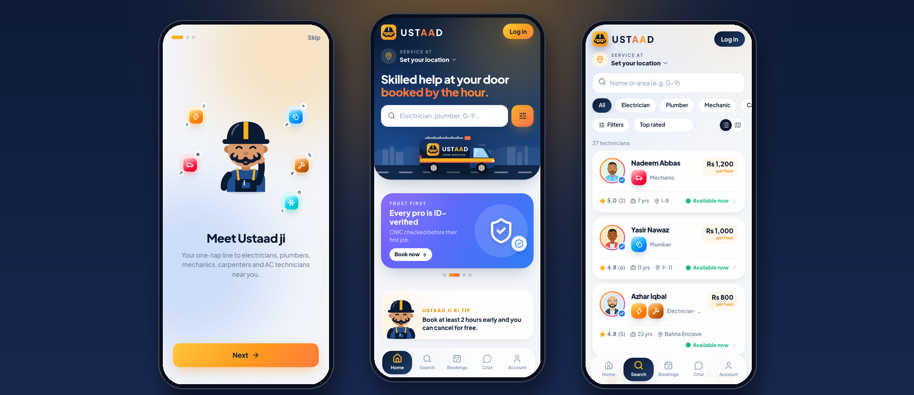
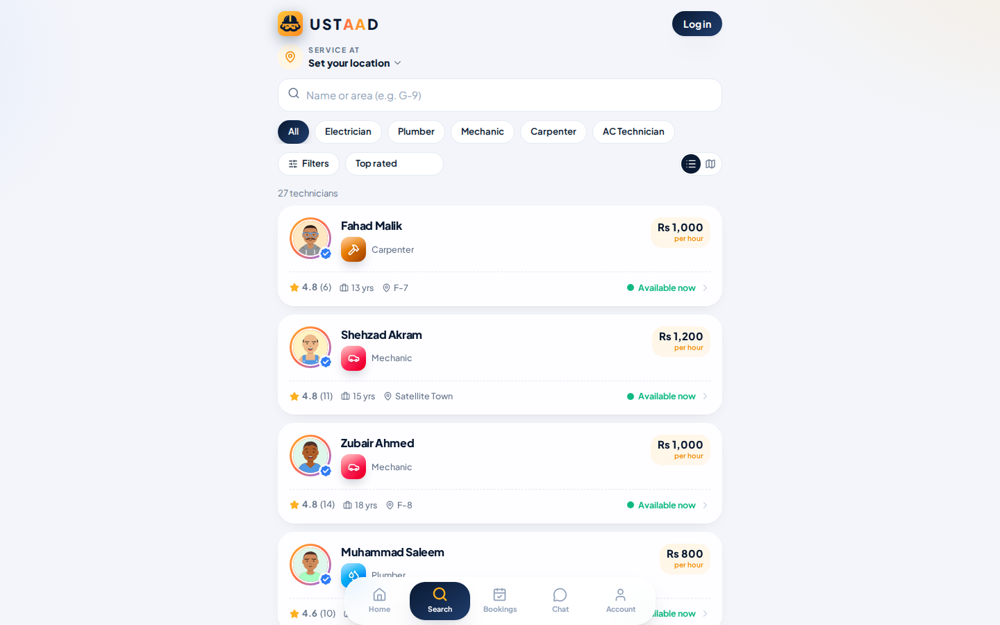
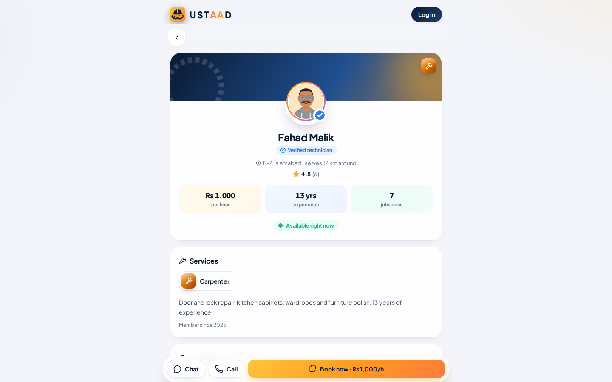
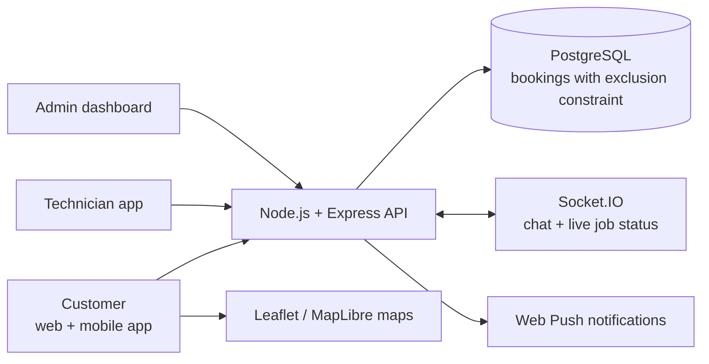

# USTAAD

**Mobile web app & marketplace**

A mobile-first marketplace for booking nearby electricians, plumbers, mechanics, carpenters and AC technicians by the hour, with separate apps for customers, technicians and admins.

[**Open the live demo**](https://ustaad.twinstackstudio.com) · [**Work with TwinStack Studio**](https://twinstackstudio.com/contact)

> **Note:** The demo runs on sample data that resets every night; the login page has one-tap demo accounts. SMS codes are shown on screen and online payments use a sandbox checkout until a real provider is connected.

## What it does

- Customers find verified technicians on a list or map, filter by service, distance, price and rating, chat, book a time and pay cash or online
- Live job tracking from Pending to Completed, with a map of the technician on the way and an arrival estimate
- Technicians set services, hourly rate, service area and working hours, accept jobs and track earnings
- Admin dashboard to verify or suspend technicians, manage bookings, payments, refunds, complaints and pricing rules
- A technician can never be double-booked: a PostgreSQL exclusion constraint holds even under simultaneous requests
- Real-time chat and status updates over Socket.IO, phone notifications through Web Push, installable to the home screen

## Screenshots

| Find a technician | Technician profile |
| --- | --- |
|  |  |

## Technology

| Layer | Stack |
| --- | --- |
| Web app | React, TypeScript, Tailwind CSS, Leaflet |
| Mobile app | React Native, Expo, MapLibre |
| Backend | Node.js, Express, Socket.IO, Web Push |
| Database | PostgreSQL |

## Architecture

## Source code

This is the public showcase. The source code is kept in a private repository. Try the live demo above, and [contact TwinStack Studio](https://twinstackstudio.com/contact) for a walkthrough or a similar project.

## Built by TwinStack Studio

TwinStack Studio builds full-stack websites, web applications, mobile apps,
dashboards, portals, automation, and AI-powered products.

[GitHub](https://github.com/twinstack-studio) ·
[Website](https://twinstackstudio.com) ·
[Email](mailto:hello@twinstackstudio.com)

© 2026 TwinStack Studio. All rights reserved. See [LICENSE](./LICENSE).
